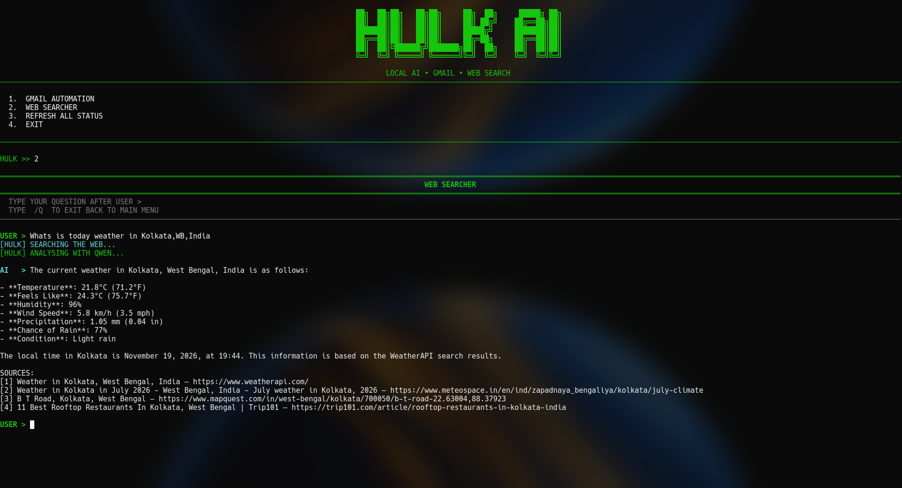

# LOCAL-AI-SEARCH

<p align="center">
  <strong>A Python-based AI assistant powered by Ollama, Gmail API and Tavily Web Search.</strong>
</p>


## About the Project

LOCAL-AI-SEARCH is a Python-based AI assistant that combines a locally running Ollama language model with Gmail automation and Tavily web search.

It helps users analyse emails, generate email drafts, and search the web using AI-generated answers.

The application runs through an interactive terminal interface.

## Features

### 1. Local AI with Ollama
- Connects to a local Ollama server.
- Uses a configurable AI model.
- Generates AI responses using the Ollama API.
- Keeps model inference on the configured Ollama service.

### 2. Gmail Automation
- Connects to Gmail using Google OAuth authentication.
- Retrieves recent emails.
- Analyses email content using Ollama.
- Identifies important information and possible actions.
- Generates email subjects and message bodies.
- Saves generated messages as Gmail drafts after confirmation.

**Note:** The application saves drafts; it does not automatically send emails.

### 3. Tavily Web Search
- Searches the internet using Tavily.
- Retrieves up to four search results.
- Uses Ollama to analyse the returned information.
- Displays AI-generated answers with source URLs.

### 4. Service Status
Checks the configuration and connection status of:
- Gmail
- Ollama
- Tavily API key

## Screenshots

### Main Menu


## Requirements

- Python 3
- pip
- Ollama
- An installed Ollama model
- Tavily API key
- Google Cloud project
- Gmail API and OAuth credentials
- Internet connection for Gmail and web search

## Installation

### 1. Clone the repository

```bash
git clone [YOUR_GITHUB_REPOSITORY_URL](https://github.com/sayan08880/LOCAL-AI-SEARCH.git)
cd LOCAL-AI-SEARCH
```

### 2. Create a virtual environment

```bash
python3 -m venv .venv
source .venv/bin/activate
```

### 3. Install dependencies

```bash
python -m pip install --upgrade pip
pip install -r requirements.txt
```

### 4. Configure environment variables

```bash
cp .env.example .env
nano .env
```

Example configuration:

```env
OLLAMA_URL=http://localhost:11434
OLLAMA_MODEL=qwen2.5:1.5b

TAVILY_API_KEY=YOUR_TAVILY_API_KEY

GMAIL_CLIENT_FILE=credentials.json
GMAIL_TOKEN_FILE=token.json
GMAIL_MAX_READ=5
```

Replace the example API key with your own.

## Ollama Setup

Install Ollama:

https://ollama.com/download

Download the default model:

```bash
ollama pull qwen2.5:1.5b
```

Start Ollama:

```bash
ollama serve
```

Check installed models:

```bash
ollama list
```

## Gmail API Configuration

1. Open Google Cloud Console.
2. Create a Google Cloud project.
3. Enable Gmail API.
4. Configure the OAuth consent screen.
5. Create OAuth credentials.
6. Select Desktop Application.
7. Download the credentials JSON file.
8. Rename it to `credentials.json`.
9. Place it in the project directory.
10. Connect your Gmail account through the application.

Google Cloud Console:

https://console.cloud.google.com/

The application uses Gmail read-only and compose permissions.

## Running the Application

Activate the virtual environment:

```bash
source .venv/bin/activate
```

Start the application:

```bash
python main.py
```

## Project Structure

```text
LOCAL-AI-SEARCH/
│
├── main.py
├── requirements.txt
├── README.md
├── .env.example
├── .env
├── credentials.json
├── token.json
│
├── hulk/
│   ├── __init__.py
│   ├── cli.py
│   ├── config.py
│   ├── gmail_ai.py
│   ├── gmail_service.py
│   ├── ollama_client.py
│   └── web_search.py
│
└── screenshots/
    ├── main-menu.png
    ├── gmail-menu.png
    ├── gmail-analysis.png
    ├── email-draft.png
    ├── web-search.png
    └── system-status.png
```

## Technologies Used

| Technology | Purpose |
|---|---|
| Python | Main programming language |
| Ollama | Local AI model execution |
| Qwen | AI language model |
| Gmail API | Email integration |
| Google OAuth | Gmail authentication |
| Tavily | Web search |
| Requests | HTTP communication |
| Python-dotenv | Environment configuration |

## Security

- Never upload `.env` to GitHub.
- Never publish `credentials.json`.
- Never share `token.json`.
- Keep API keys private.
- Review AI-generated email drafts before sending.
- Do not expose your Ollama service to untrusted networks.

If credentials have already been published, rotate or revoke them.

## Limitations

- Ollama must be installed and running separately.
- Web search requires a valid Tavily API key.
- Gmail requires Google OAuth authentication.
- Gmail email retrieval is limited to five messages.
- Tavily search retrieves up to four results.
- The supplied project is a terminal application, not a native desktop GUI.

## Future Improvements

- Native Linux desktop application.
- AppImage distribution.
- Improved graphical user interface.
- Chat history management.
- More AI model support.
- Additional search providers.
- Improved email analysis and reporting.

## License

No license was included in the supplied project archive. Add a suitable LICENSE file before granting public reuse or distribution rights.

---

**LOCAL-AI-SEARCH — Local AI assistance, Gmail automation and web search in one Python application.**
